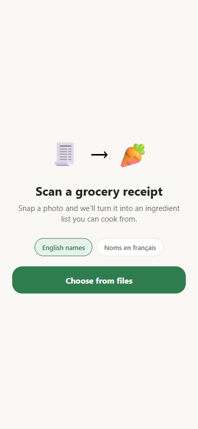
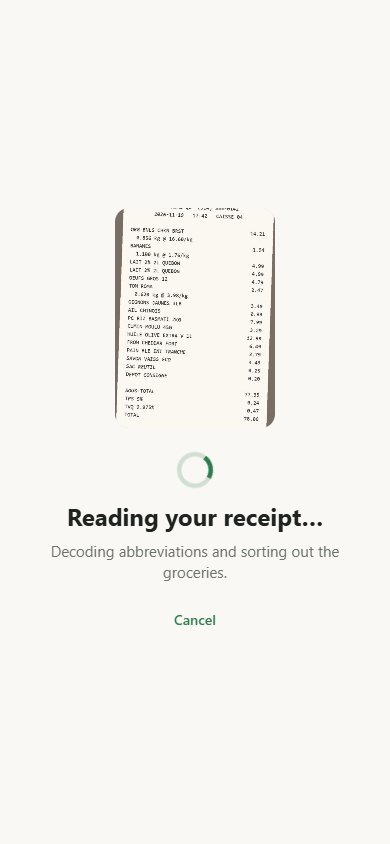
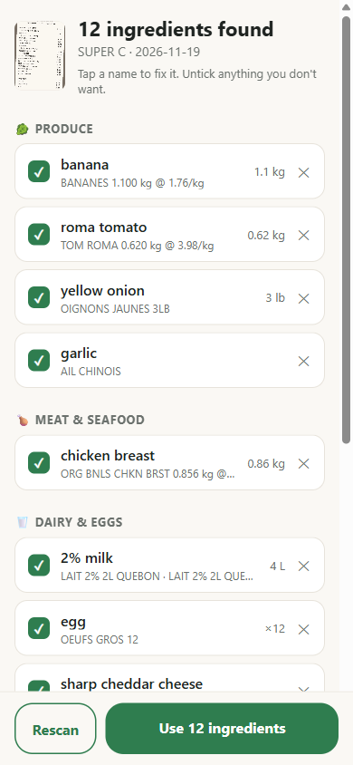
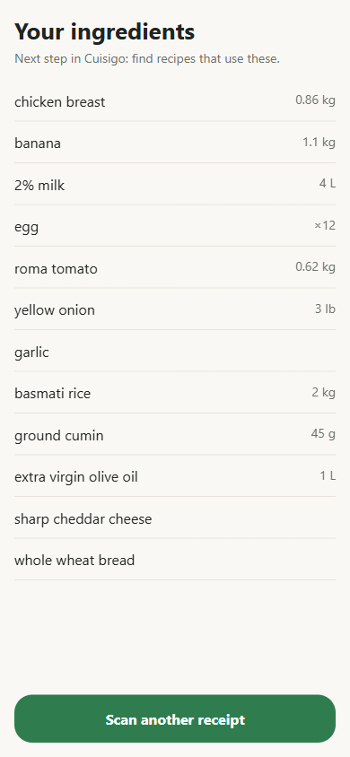
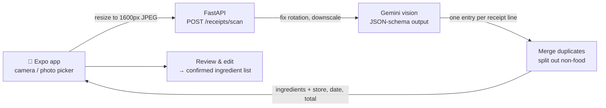

# Cuisigo Scan: from grocery receipt to recipe-ready ingredients

**Photograph a grocery receipt and get back a clean, editable list of what you can cook with.** The receipt's cryptic store abbreviations become real ingredients: `ORG BNLS CHKN BRST` becomes *chicken breast*, `LAIT 2% 2L` ×2 becomes *2% milk, 4 L*, and `HUILE OLIVE EXTRA V 1L` becomes *extra virgin olive oil*. Bags, deposits and soap are set aside automatically.

Built for the **Creators AI Winter Challenge** as a new feature for [Cuisigo.ca](https://cuisigo.ca), a recipe app.

<p>
  
  
  
  
</p>

*Real output from Gemini on [`samples/receipt_superc.jpg`](samples/receipt_superc.jpg), a French-Canadian Super C receipt.*

## The problem

Recipe apps ask "what's in your kitchen?", and nobody wants to type 20 items after every grocery run. The receipt already lists everything you bought, but it's written for the store's till, not for people:

- **Truncated, abbreviated names:** `PAIN BLE ENT TRANCHE`, `FROM CHEDDAR FORT`
- **Mixed languages:** Quebec receipts are mostly French, while many users cook in English
- **Noise:** taxes, deposits, bags, loyalty lines, cleaning products
- **Repeats and weights:** two cartons of milk on separate lines, `0.856 kg @ 16.60/kg`

Regular OCR gives you the text but not its meaning. This project uses a vision model to understand the receipt the way a person would.

## Who it's for

- **Home cooks** who want recipe suggestions based on what they just bought, without typing.
- **Students and budget shoppers** who want to cook with what they already have and waste less food.
- **Cuisigo**: this is the first step towards "cook from my groceries": scan, then see recipes you can make right now.

## What it does

| Feature | Details |
|---|---|
| 📸 **Scan or upload** | Take a photo with the camera, or pick one from your photos or files (on the web) |
| 🧠 **Understands receipts** | Decodes abbreviations, picks the generic ingredient a recipe would ask for, and drops brands and sizes |
| 🇨🇦 **English & French** | Reads both, and returns ingredient names in the language you choose |
| ⚖️ **Quantities** | Reads weights (`0.856 kg`), counts (`OEUFS GROS 12` → 12 eggs) and pack sizes |
| ➕ **Merges duplicates** | Two `LAIT 2% 2L` lines become *2% milk, 4 L* |
| 🧴 **Filters non-food** | Bags, deposits, soap, taxes and totals are left out (and can be shown) |
| ✏️ **Human in the loop** | Grouped by aisle: untick, rename, or add anything that was missed; low-confidence items are flagged "check" |
| 🛟 **Resilient** | If the main Gemini model is overloaded, the API retries and falls back to a second model automatically |

## How it works



1. **App** (`mobile/`, Expo + React Native + TypeScript) takes or picks a photo, shrinks it on the device and uploads it.
2. **API** (`backend/`, FastAPI) straightens and downsizes the image with Pillow, then sends it to **Gemini** with a prompt about Canadian grocery receipts and a strict JSON schema, defined as Pydantic models. Every line comes back as `{raw_text, ingredient, category, quantity, unit, is_food, confidence}`.
3. Plain Python code then merges duplicates, adds up quantities, and separates food from non-food. The model reads the receipt, and ordinary code does the counting.
4. **App** shows the result grouped by category, so you can fix anything before confirming.

## Try it

### Fastest: no API key needed (mock mode)

```bash
cd backend
python -m venv .venv
.venv\Scripts\activate            # macOS/Linux: source .venv/bin/activate
pip install -r requirements.txt
copy .env.example .env            # macOS/Linux: cp .env.example .env
# in .env set RECEIPT_MOCK=1
uvicorn app.main:app --host 0.0.0.0 --port 8000
```

```bash
cd mobile
npm install
npx expo start --web              # opens the app in your browser
```

Click **Choose from files** and pick any image. Mock mode returns a sample Metro receipt.

### With real AI

1. Get a free Gemini API key at [aistudio.google.com/apikey](https://aistudio.google.com/apikey).
2. Put it in `backend/.env` as `GEMINI_API_KEY=...` and set `RECEIPT_MOCK=0`.
3. Restart the API and scan [`samples/receipt_superc.jpg`](samples/receipt_superc.jpg) or a photo of your own receipt.

**On a phone:** run `npx expo start` in `mobile/` and scan the QR code with the Expo Go app. The phone must be on the same Wi-Fi as the computer; the app finds the API at `<your-computer-IP>:8000` on its own. To use another server, set `EXPO_PUBLIC_API_URL`.

**Tests:** `cd backend && pip install -r requirements-dev.txt && pytest` (10 tests, no network needed).

## API

`POST /receipts/scan?lang=en|fr` with a multipart `image` field.

```json
{
  "store_name": "SUPER C",
  "purchase_date": "2026-11-19",
  "currency": "CAD",
  "total": 78.06,
  "ingredients": [
    { "name": "2% milk", "category": "dairy_eggs", "quantity": 4, "unit": "L",
      "confidence": "high", "source_lines": ["LAIT 2% 2L QUEBON", "LAIT 2% 2L QUEBON"] }
  ],
  "non_food_lines": ["SAVON VAISS ECO", "SAC REUTIL", "DEPOT CONSIGNE"],
  "model": "gemini-3.5-flash-lite"
}
```

Errors return `{"detail": "<human-readable message>"}` with status 400, 413, 422, 429, 500, 502 or 503, and the app shows that message as is.

### Configuration (`backend/.env`)

| Variable | Default | Purpose |
|---|---|---|
| `GEMINI_API_KEY` | none (required) | Your Gemini key. It is only ever read from `.env` or the environment |
| `GEMINI_MODEL` | `gemini-3.8-flash` | Main model; `gemini-3.5-flash-lite` is faster (about 4 s per receipt) and cheaper |
| `GEMINI_FALLBACK_MODEL` | `gemini-3.5-flash-lite` | Used when the main model is overloaded or rate-limited; leave empty to disable |
| `RECEIPT_MOCK` | `0` | `1` returns a canned receipt without calling Gemini |

**Secrets:** the key lives only in `backend/.env`, which is git-ignored. Only `.env.example` (empty) is committed. In production, set `GEMINI_API_KEY` as an environment variable on the host; it takes precedence over `.env`.

## Tech stack

- **AI:** Google Gemini (`google-genai` SDK) with vision input and structured JSON-schema output
- **Backend:** Python, FastAPI, Pydantic, Pillow, pytest
- **Mobile:** Expo SDK 58, React Native 0.88, TypeScript, expo-image-picker, expo-image-manipulator; also runs on the web through react-native-web

## Project structure

```
backend/app/receipts/      # self-contained feature: router, Gemini service, schemas, mock data
backend/tests/             # merge logic, endpoint, Gemini request shape, fallback, error cases
mobile/src/features/receiptScan/   # self-contained screen, API client, image picking, theme
samples/                   # sample receipt for demos
docs/screenshots/          # screenshots used above
```

## Adding it to Cuisigo

Both halves are self-contained folders, so moving them into the existing Cuisigo app means copying one folder on each side.

**FastAPI:** copy `backend/app/receipts/` into the API, add `google-genai`, `pillow` and `python-dotenv` to the dependencies, put `GEMINI_API_KEY` in Cuisigo's `.env`, then:

```python
from app.receipts.router import router as receipts_router
app.include_router(receipts_router, dependencies=[Depends(get_current_user)])  # reuse existing auth
```

**React Native:** copy `mobile/src/features/receiptScan/` and run `npx expo install expo-image-picker expo-image-manipulator react-native-safe-area-context expo-constants`. Then add the `expo-image-picker` plugin block from `mobile/app.json` (it holds the camera permission text) and mount the screen:

```tsx
<ReceiptScanScreen
  scanOptions={{ apiUrl: API_URL, headers: { Authorization: `Bearer ${token}` } }}
  onConfirm={(ingredients) => {
    // save to pantry, then open recipe search filtered by ingredients.map(i => i.name)
  }}
/>
```

Colours live in `receiptScan/theme.ts` and can be swapped for Cuisigo's design tokens.

## What's next

- **Recipe matching:** rank Cuisigo recipes by how many scanned ingredients they use ("you can make 14 recipes tonight").
- **Pantry over time:** save scans and estimate what's running low, with expiry nudges to cut food waste.
- **Ingredient IDs:** map names to Cuisigo's ingredient catalogue for exact matching.
- **Spending insights:** prices are already extracted for every line.

## Originality and ownership

- **Written during the hackathon:** everything in this repository: the receipt-reading prompt and schema, the merge logic, the API, the review screen, the tests and the sample receipt. Cuisigo.ca is the founder's existing recipe app; this repository doesn't contain any of its code. It's designed to plug into Cuisigo later.
- **Third-party tools:** the mobile app was started from the official Expo `blank-typescript` template (`mobile/LICENSE`). It uses open-source libraries (FastAPI, Pydantic, Pillow, React Native, Expo) and the Google Gemini API under their own licences and terms.
- **AI assistance:** development was assisted by an AI coding assistant (Claude Code).
- **No secrets:** the repository contains no API keys or personal data. The sample receipt is synthetic.
